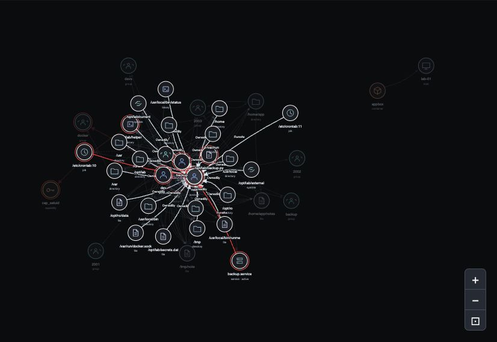
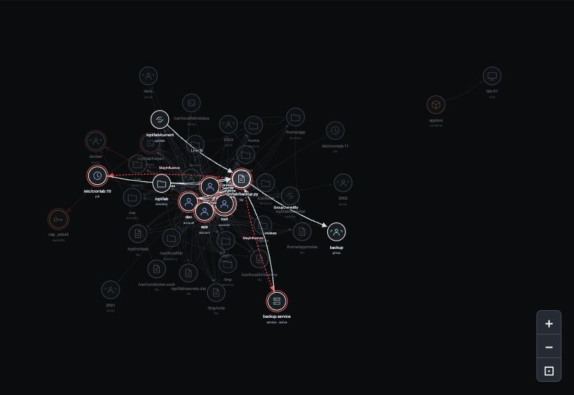
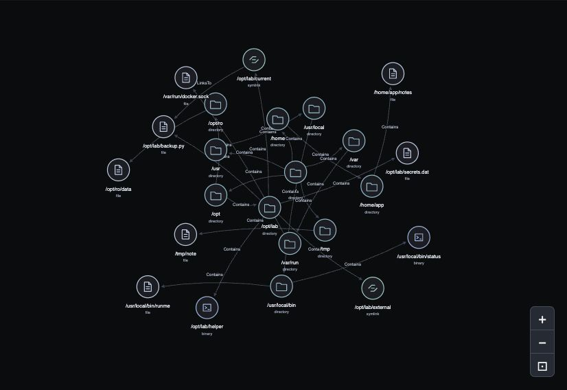
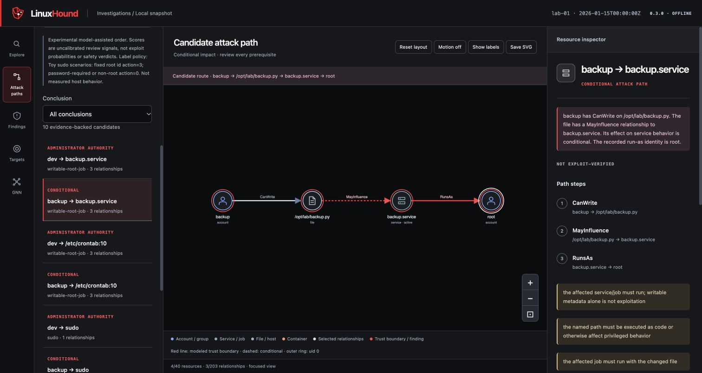
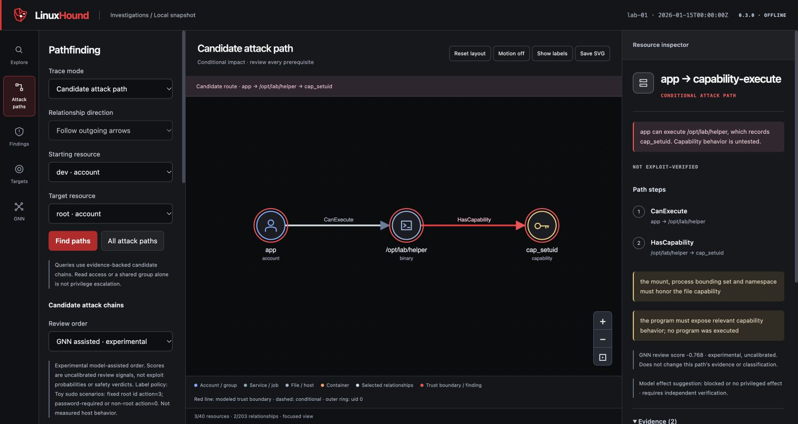

# LinuxHound user guide

This guide takes you from your first Linux collection to investigating permission
relationships, comparing hardening changes and using optional neural models to
prioritize the paths you review.

[← Quick start](README.md)

[Investigating results](#what-the-results-show) · [Docker](#docker) ·
[Graph Neural Network (GNN)](#graph-neural-network-gnn) ·
[Coverage and limitations](#coverage-privacy-and-limitations)

## Collection and report access

Root is optional; unreadable sources remain coverage gaps. For a fuller authorized
scan, use `sudo .venv/bin/linuxhound scan --root /etc --root /opt`, then transfer
only the intended root-owned report. Repeat `--root` to expand scope. Add
`--docker` for explicit local Docker metadata discovery. ACL collection uses
`getfacl` when available. By default, collection is bounded to 60 seconds,
5,000 files and a directory depth of 8.

`--serve` starts a localhost viewer; `--open` opens its token URL. Omit both on a
headless host and copy `index.html` to a trusted desktop. Omit `--serve` to open
the standalone HTML directly. Account names and filesystem metadata may be sensitive;
keep collected reports private.

## What the results show

| View | What you can investigate |
| --- | --- |
| Explore | Effective read, write, execute, replace and traversal relationships |
| Attack paths | Candidate privilege chains, direction and prerequisites |
| Findings | Configuration exposures and supporting evidence |
| Targets | Relationships leading into a selected resource |
| GNN | Feature values, missing-data masks and optional neural review ordering |

Select a node or edge to inspect its evidence. Expand neighbors, trace relationships,
filter services, toggle labels and export an SVG. Motion honors reduced-motion
preferences. A relationship trace establishes connectivity, not exploitability.

```sh
linuxhound view report.json --output review.html --open
linuxhound view after.json --before before.json --output comparison.html --open
linuxhound serve review.html --port 0
```

Comparisons distinguish removed permissions from missing coverage. The viewer
serves only the selected HTML on loopback; its private token URL grants access.

## Graph examples

Start by selecting an account. The graph highlights its incoming and outgoing
relationships so you can follow how other resources connect to it.



Next, select a file to follow its ownership, group membership and job references.
These relationships help explain who controls the file and which jobs may consume it.



The filesystem view below retains containment and symlink relationships from the
demo graph. It shows where resources sit and how a link points to another path.



Following the candidate chain `backup → backup.py → backup.service → root`
connects a writable file to a service running as root. The inspector explains
the supporting evidence and the prerequisites that keep this path conditional.



## Graph Neural Network (GNN)

```sh
python -m pip install '.[gnn]'
linuxhound demo --gnn --open
```



*The demo attaches neural scores to existing paths. Evidence and conditional
classifications remain unchanged—even when a model suggests a different effect.*

The GNN uses directed message passing over permission relationships. The
path-specific model also represents relationship order and prerequisite states.
Features use explicit missing-value masks; secret contents are not inputs.
Choose **GNN → Review ranked paths** to inspect model-assisted ordering.

**The bundled model is a synthetic demonstration, with no validated real-world
accuracy.** Scores are uncalibrated review signals. They do not prove a vulnerability
or establish that a low-scoring path is safe.

### Use your own model or train one

Keep `model.safetensors` and its checksum-bound `model.json` companion together:

```sh
linuxhound gnn-rank report.json --model model.safetensors --output ranked.json
linuxhound view ranked.json --output ranked.html --open
linuxhound gnn-features training-report.json --output training-features.json
linuxhound gnn-train labels.json --epochs 100 --output model.safetensors
```

The node-model manifest uses report paths relative to its directory. Replace
hashes and node IDs with values from the feature exports:

```json
{
  "reviewer": "review-team",
  "label_policy": "1 = prioritize review; 0 = lower priority, not proven safe",
  "graphs": [
    {"report": "training-report.json", "split": "train", "source_host_id": "host-A",
     "snapshot_sha256": "TRAIN_HASH", "labels": {"NODE_A": 1, "NODE_B": 0}},
    {"report": "validation.json", "split": "validation", "source_host_id": "host-B",
     "snapshot_sha256": "VALIDATION_HASH", "labels": {"NODE_C": 1, "NODE_D": 0}}
  ]
}
```

Both splits require positive and negative reviewed labels and genuinely separate
source hosts. Renaming IDs does not create independent hosts. Retain an untouched
final test set and compare predictions against a rule baseline.

Path-effect models use `gnn-path-features` and `gnn-path-train`. Their manifests
also require `threat_model`, ordered `outcomes`, each graph's `reference_sha256`
(null without a catalog), and labels keyed by path/candidate ID. The effect classes are ordered as follows: `blocked_or_no_privileged_effect`, `privileged_read`, `privileged_write`,
`limited_root_action`, `root_code_execution`. Root `id` is a limited action,
not arbitrary code execution.

The bundled Apache-2.0 model uses six one-edge sudo demo scenarios: three
training and three validation fixtures from `scripts/build_demo_model.py`, seed 7,
30 epochs. Scenario families overlap across splits. Only blocked/no-effect and
limited-root-action classes have toy labels; read, write and root code execution
are unsupported. No real-host data or third-party catalog trained this model.
Reproduce it with `python scripts/build_demo_model.py --output demo-model/demo-path.safetensors`.
PyTorch versions may change floating-point results. Loading uses SafeTensors,
validated schemas, tensor shapes and checksums; no pickle.

## Docker

Docker provides a convenient way to run the demo, use the CLI and render saved
reports. For a host audit, collect directly on Linux, because a scan inside a
container describes that container.

### Install Docker

For a fresh Ubuntu installation, the following commands use [Docker's official apt repository](https://docs.docker.com/engine/install/ubuntu/).
If Docker or another container runtime is already installed, follow that page's
prerequisites before changing packages. Skip installation when Docker already works.

```sh
sudo apt update
sudo apt install ca-certificates curl
sudo install -m 0755 -d /etc/apt/keyrings
sudo curl -fsSL https://download.docker.com/linux/ubuntu/gpg -o /etc/apt/keyrings/docker.asc
sudo chmod a+r /etc/apt/keyrings/docker.asc
sudo tee /etc/apt/sources.list.d/docker.sources <<EOF
Types: deb
URIs: https://download.docker.com/linux/ubuntu
Suites: $(. /etc/os-release && echo "${UBUNTU_CODENAME:-$VERSION_CODENAME}")
Components: stable
Architectures: $(dpkg --print-architecture)
Signed-By: /etc/apt/keyrings/docker.asc
EOF
sudo apt update
sudo apt install docker-ce docker-ce-cli containerd.io docker-buildx-plugin docker-compose-plugin
sudo docker run --rm hello-world
```

If you use another Linux distribution, follow its corresponding [Docker Engine installation guide](https://docs.docker.com/engine/install/).

On a Mac, you can run the demo and render saved reports with [Docker Desktop](https://docs.docker.com/desktop/setup/install/mac-install/)
installed for your chip. Launch the application and check `docker info` before
continuing. This does not enable
live collection of macOS permissions.

### Build and run LinuxHound with Docker

With Docker running, open a terminal in the checkout root. Build the image and
run the demo, saving its output in a folder on your computer:

```sh
docker build -t linuxhound:local .
mkdir -p linuxhound-results
docker run --rm --network none --read-only --cap-drop ALL \
  --security-opt no-new-privileges --pids-limit 128 --memory 512m --cpus 1 \
  --user "$(id -u):$(id -g)" --tmpfs /tmp:rw,noexec,nosuid,size=32m \
  --mount "type=bind,src=$PWD/linuxhound-results,dst=/data" \
  linuxhound:local demo --output-dir /data
```

On Linux, prefix `docker build` and `docker run` with `sudo` if your Docker setup
requires it. Keep the output folder owned by your user. Open the generated
`linuxhound-results/<run>/index.html` on your desktop.

For GNN dependencies, build with
`--build-arg INSTALL_GNN=true`, use a separate image tag, allow at least 2 GiB
of memory and run `demo --gnn --output-dir /data`. No host-root mount,
Docker socket or privileged mode is required for these demos.

## Additional commands and remote viewing

```sh
linuxhound paths report.json --account backup --root-jobs
linuxhound services report.json --running
linuxhound who report.json --resource /opt/example/job.py --right write
linuxhound export-opengraph report.json --output opengraph.json
python scripts/update_gtfobins.py --output catalog.json
linuxhound techniques-match report.json --catalog catalog.json --output matched.json
```

[GTFOBins](https://gtfobins.org/) import is an explicit download of reference metadata, excluding exploit
recipes. A reference match is not vulnerability validation. Models trained with
a catalog require its exact frozen checksum at inference. Normal collection and
inference remain offline. Third-party reference data is not bundled.

For remote viewing, leave the listener on loopback and use
`ssh -L 8765:127.0.0.1:8765 USER@HOST`. Explicit host-IP serving uses plain HTTP;
use only a trusted network and keep the token URL private.

## References and acknowledgements

[BloodHound](https://bloodhound.specterops.io/home) is the reference for LinuxHound's
graph-based investigation approach. Its
[OpenGraph framework](https://bloodhound.specterops.io/opengraph/overview) supports
custom resource types and relationships. LinuxHound's `export-opengraph` command
produces those objects with export fidelity notes. Conditional privilege edges
remain non-traversable, so BloodHound pathfinding does not treat unresolved
prerequisites as established access.

[GTFOBins](https://gtfobins.org/) documents ways Unix executables can be used
under particular permission and execution conditions. LinuxHound's optional
import retains reference metadata and prerequisite information, excluding exploit
recipes. It does not execute techniques or bundle the catalog, and a reference
match does not make the executable a verified vulnerability. The demo model is
not trained on GTFOBins data.

## Coverage, privacy and limitations

Collection reads metadata and bounded supported policy files, without changing
configuration, installing packages or executing exploit paths. It excludes
arbitrary file contents, process environments, password hashes and secrets.
Account names, paths and relationships still contain sensitive metadata.

Coverage is reported per source. Root access does not make a bounded scan a
complete host audit. Missing evidence is not a clean result or a verified fix.

SUID bits, capabilities, sudo rules, Docker membership and writable root-job
operands are review signals. Program behavior, authentication, execution phase,
namespace mappings and whether a job consumes a file as code remain prerequisites.

Sudo aliases, Defaults and includes may remain unresolved. Loaded systemd services
are not every installed or future unit. Shell imports, relative commands,
AppArmor/SELinux/seccomp and full user-namespace semantics are not modeled.

The tool does not scan CVEs or test container escapes. OpenGraph exports retain
fidelity notes; conditional privilege edges remain non-traversable.

A verified label requires separately supplied validation evidence tied to the
exact path and snapshot. A model score or user-supplied JSON claim is not proof.

Keep real reports and private training artifacts out of public issues. Use private
vulnerability reporting when enabled, or arrange a private channel first.

## Development and license

```sh
python -m unittest discover -s tests -q
node tests/test_viewer_graph.js
python scripts/check_public_release.py
```

Core collection and rendering use the Python standard library. The optional GNN
dependencies include PyTorch, SafeTensors and NumPy. README.md and GUIDE.md are the public documentation; screenshots use
demo data. Licensed under [Apache-2.0](LICENSE); see [NOTICE](NOTICE).
