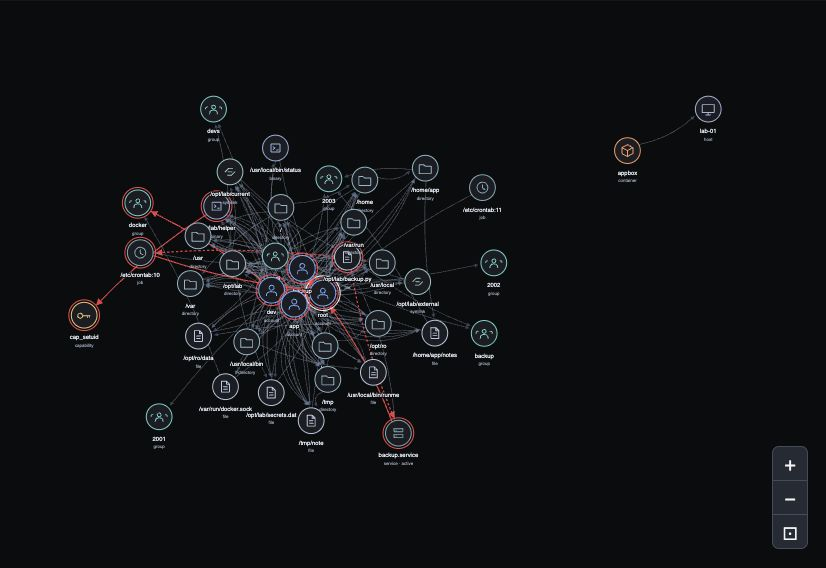

<p align="center">
  
</p>

# LinuxHound

LinuxHound follows the permissions that connect Linux accounts to files, services
and containers, helping you understand how access can lead to privileged resources.
It collects metadata, builds a directed relationship graph and opens an offline
investigation UI, where you can examine the evidence behind each path and compare
what changes after hardening.

**Live collection:** Linux only. macOS, BSD and Windows are not collection
targets. Saved HTML reports open in a modern desktop browser. The fictional demo
can run elsewhere with Python; it does not audit that operating system.



The graph above comes from a fictional Linux lab. Red relationships mark modeled
trust boundaries, while dashed relationships retain unresolved prerequisites.
Following a connection helps explain access, but does not establish that an exploit works.

## Quick start: Linux

To begin, open the checkout on a Linux host with Python 3.9 or newer. Create a
virtual environment, install LinuxHound and run your first collection:

```sh
python3 -m venv .venv
. .venv/bin/activate
python -m pip install .
linuxhound scan --root /etc --root /opt --serve --open
```

When collection finishes, LinuxHound feeds the results directly into the UI.
Each run saves `snapshot.json`,
`report.json` and `index.html` under `linuxhound-results/`. `--serve --open` opens
a localhost viewer. On a headless host, omit those flags and copy the HTML to a
trusted desktop. The package is not yet published to PyPI.

If you want to explore the interface first, open the fictional demo without
collecting information from a host:

```sh
linuxhound demo --open
```

Once you are familiar with the graph, you can install the optional
**Graph Neural Network (GNN)** dependencies and explore neural review ordering:

```sh
python -m pip install '.[gnn]'
linuxhound demo --gnn --open
```

The bundled model is an uncalibrated synthetic demonstration. Its scores help
order reviews; they do not prove vulnerabilities or safety. Missing collection
coverage is not a clean result.

## User guide

Continue with the [user guide](GUIDE.md) for
[Docker installation](GUIDE.md#docker),
[investigating paths and comparing snapshots](GUIDE.md#what-the-results-show),
and [more graph examples](GUIDE.md#graph-examples). It also explains
[GNN models and training](GUIDE.md#graph-neural-network-gnn),
[collection scope and limitations](GUIDE.md#coverage-privacy-and-limitations),
and [development](GUIDE.md#development-and-license).

LinuxHound is licensed under [Apache-2.0](LICENSE). Attribution information is
available in [NOTICE](NOTICE).
